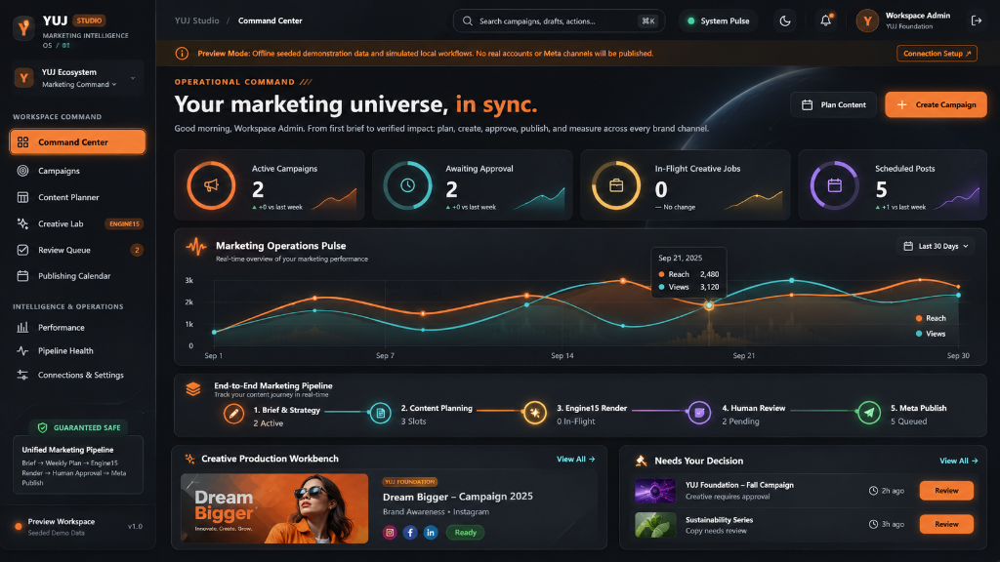
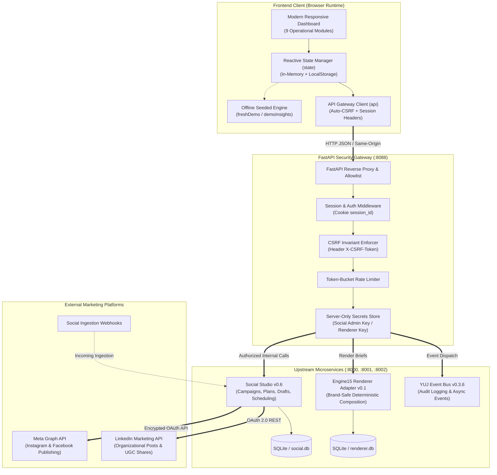
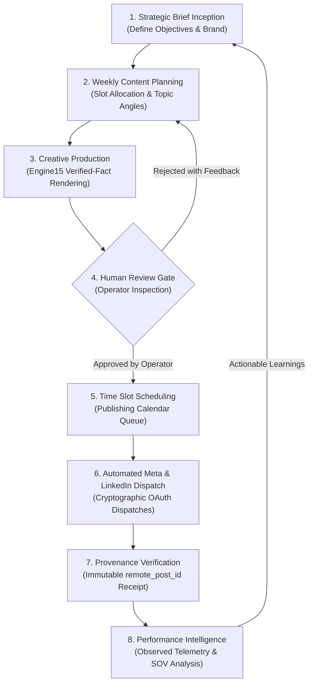
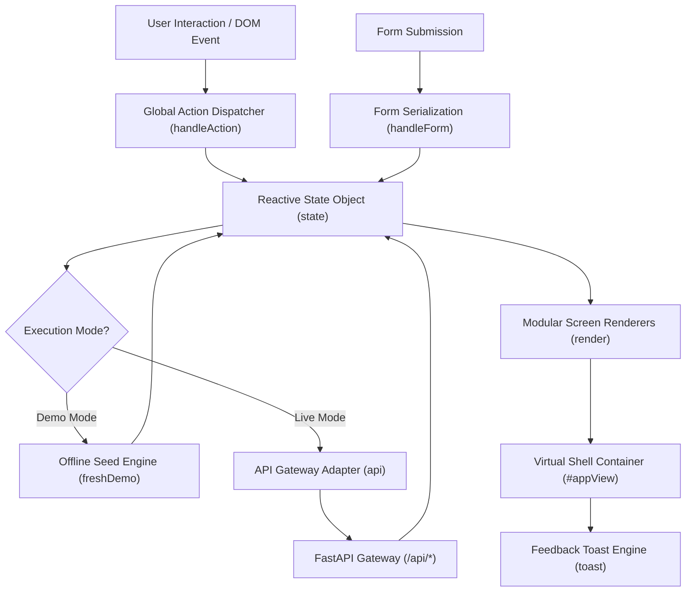
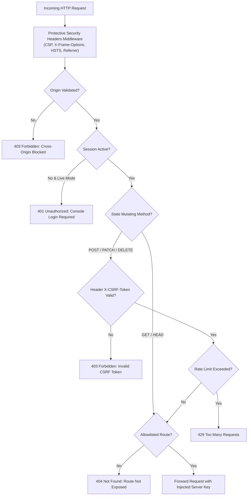
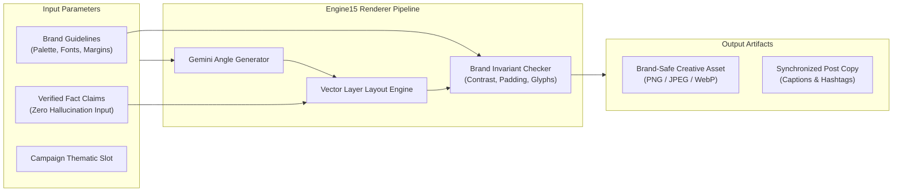
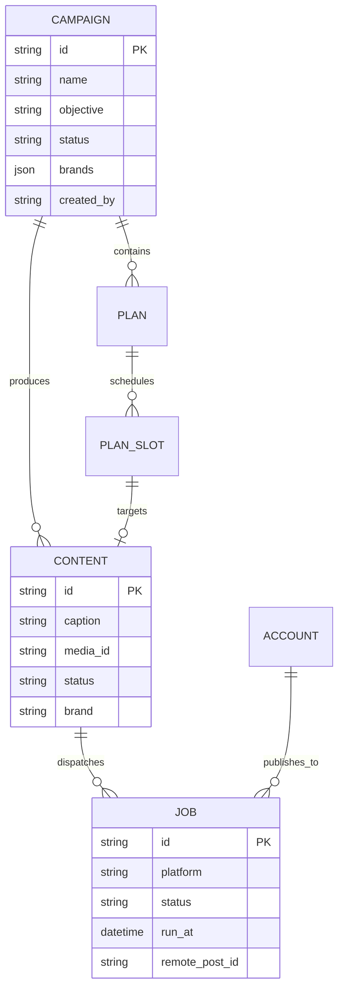
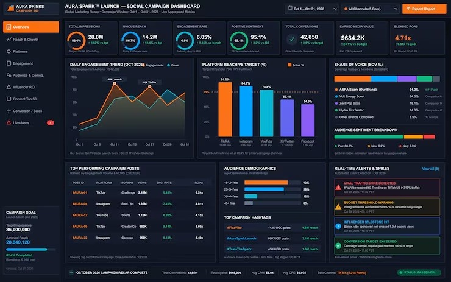

# YUJ Studio — Marketing Intelligence OS

<div align="center">



### The Autonomous, Brand-Safe Marketing Command Center

**AI-powered marketing campaign management, creative production, content planning, human approval workflows, multi-platform publishing, and performance analytics.**

[](https://aadibytes7.github.io/YUJSTUDIO/)
[](https://python.org)
[](https://fastapi.tiangolo.com)
[](https://developer.mozilla.org/en-US/docs/Web/JavaScript)
[](https://www.w3.org/Style/CSS/)
[](LICENSE)
[](#frontend-architecture)
[](docs/SECURITY.md)

[Overview](#overview) • [Key Features](#key-features) • [System Architecture](#system-architecture) • [Workflow](#complete-workflow) • [Screenshots](#screenshots) • [Quickstart](#installation-instructions) • [Documentation](#technical-documentation-hub)

</div>

---

## 1. Overview

**YUJ Studio (Marketing Intelligence OS / 01)** is a unified enterprise marketing command center that closes the loop between strategic campaign briefs, editorial planning, deterministic creative rendering, human approval checkpoints, automated social media publishing, and multi-channel performance telemetry.

Built on an **Obsidian Deep Graphite (`#0B0E13`)**, **Burnt Orange (`#FF873E`)**, and **Electric Teal (`#27C7C1`)** design system, YUJ Studio replaces fragmented marketing stacks with a cohesive, mission-critical operations center.

---

## 2. Problem Statement

Modern enterprise marketing teams face severe operational friction:
1. **Disconnected Stacks**: Strategy happens in documents, planning in spreadsheets, creative generation in separate AI tools, approvals over email, and scheduling inside native social platform dashboards.
2. **Generative AI Hallucination & Brand Drift**: Unconstrained diffusion models output ungrounded visuals that violate brand guidelines, mangle logos, and display inaccurate product facts.
3. **Accidental Dispatches**: Lacking hard automated barriers, unreviewed drafts or test copy frequently leak into live production social channels.
4. **Manufactured Metrics**: Marketing dashboards routinely fabricate synthetic conversion numbers, phantom ROAS, or unverified projections.

---

## 3. Our Solution

YUJ Studio solves these problems through an invariant-enforced architecture:
- **Unified Command Center**: A single cohesive interface covering all nine operational stages.
- **Engine15 Deterministic Renderer Adapter v0.1**: Vector-layered, brand-safe composition grounded strictly in verified fact briefs.
- **Mandatory Human-in-the-Loop Barrier**: Mathematical impossibility of dispatching unapproved creative.
- **Zero-Phantom Data Principle**: Every insight is anchored in verified Meta Graph and LinkedIn API telemetry. Unobserved values render honestly as em dashes (`—`), never synthetic projections.

---

## 4. Key Features

- **Flagship Command Center (`/overview`)**: Complete operational visibility with atmospheric celestial hero, 4 orbital KPI cards, real-time Marketing Operations Pulse SVG visualizer, and a 5-stage interactive pipeline rail.
- **Strategic Campaign Portfolio (`/campaigns`)**: Multi-brand initiative management (`YUJ Foundation`, `YUJ World`, `YUJ GreenBuild`, `YUJ Ahaar`).
- **Weekly Content Planner (`/planner`)**: Matrix-based editorial scheduling across platforms (Instagram, Facebook, LinkedIn) and formats (Carousel, Reel, Story, Post).
- **Engine15 Creative Lab (`/creative`)**: Brand-safe parameterized visual generation with verified fact injection.
- **Human Review Queue (`/reviews`)**: High-resolution visual inspection drawer with one-click approval or structured rejection.
- **Publishing Calendar Workspace (`/calendar`)**: Interactive 3-part layout (Toolbar, 7-column monthly grid, and chronological right-hand daily schedule inspector with inline rescheduling).
- **Performance Intelligence Command Center (`/analytics`)**: 7-card KPI summary strip with SVG circular gauges, daily engagement area curves with milestone badges, platform reach vs. target bars, Share of Voice (SOV) segmentation, and top posts sorting.
- **Pipeline Health & Operations (`/operations`)**: Real-time service heartbeat monitoring, rate limits, and severity-coded alert feeds.
- **Dual Execution Engine**: 100% functional offline seeded demonstration mode paired with a secure live gateway mode.

---

## 5. System Architecture

### High-Level Architecture Diagram



---

## 6. Complete Workflow



---

## 7. Technology Stack

| Layer | Technologies | Key Characteristics |
|---|---|---|
| **Frontend UI** | HTML5, CSS3 Custom Properties, Vanilla ES2022 JavaScript | Zero-build toolchain, zero external package bloat, instant browser startup |
| **Data Visualization** | Raw Scalable Vector Graphics (SVG), CSS Keyframe Animations | High DPI rendering, responsive viewBox scaling, zero heavy charting libraries |
| **Security Gateway** | Python 3.10+, FastAPI, Starlette, Uvicorn, HTTPX, Pydantic | Sub-millisecond latency, CSRF token validation, reverse-proxy credential vault |
| **Persistence** | SQLite with WAL Journaling (`social.db`, `renderer.db`) | High-concurrency reads, atomic ACID transaction guarantees |
| **Creative Engine** | YUJ Engine15 Renderer Adapter v0.1 | Layered vector synthesis, WCAG AA contrast verification, brand asset locking |
| **External APIs** | Meta Graph API (v20.0), LinkedIn Marketing API (v2) | OAuth 2.0 token management, webhook subscription handling |

---

## 8. Frontend Architecture



---

## 9. Backend Architecture



---

## 10. AI Integration Architecture



---

## 11. Database Architecture



---

## 12. API Communication

Detailed in [docs/API_DOCUMENTATION.md](docs/API_DOCUMENTATION.md).

```http
# Example: Creating a Campaign via Security Gateway
POST /api/social/v1/campaigns HTTP/1.1
Host: 127.0.0.1:8088
Origin: http://127.0.0.1:8080
Cookie: session_id=s%3A...
X-CSRF-Token: 9e8a7f6c...
Content-Type: application/json

{
  "name": "Life Education 2026",
  "objective": "awareness",
  "brands": ["yuj-foundation"]
}
```

---

## 13. Security Architecture

Detailed in [docs/SECURITY.md](docs/SECURITY.md).
- **Zero-Trust Client Boundary**: Browser code holds no API master keys or platform credentials.
- **CSRF Token Invariant**: Every state-mutating request validates cryptographic HMAC token equality.
- **Timing-Attack Resistance**: Password hashes and HMAC signatures use `hmac.compare_digest`.
- **Brute-Force Protection**: IP rate limiting enforces backoff on repeated authentication failures.

---

## 14. Screenshots

<div align="center">

### Command Center Flagship Dashboard

*Atmospheric celestial hero, 4 orbital KPI cards, Marketing Operations Pulse SVG chart, 5-stage interactive pipeline rail, Creative Production Workbench, and Needs Your Decision approval queue.*

### Performance Intelligence Command Center

*7-card KPI strip with circular SVG gauges, Daily Engagement Trend area curves, Platform Reach vs. Target comparison bars, Share of Voice (SOV %) segmentation, top-performing posts table, and real-time alert feed.*

</div>

---

## 15. Installation Instructions

### Prerequisites
- Python 3.10 or higher
- Node.js 18+ (for UI test automation runners)
- Git 2.30+

### Setup
```bash
# 1. Clone the repository
git clone https://github.com/aadibytes7/YUJSTUDIO.git
cd YUJSTUDIO

# 2. Create virtual environment
python -m venv .venv
source .venv/bin/activate  # On Windows: .venv\Scripts\activate

# 3. Install dependencies
pip install -r requirements.txt
```

---

## 16. Environment Configuration

Copy the template and configure server-side parameters:
```bash
cp .env.example .env
```
Key variables:
- `ENV_MODE`: `demo` (offline simulation) or `live` (connected upstream mode).
- `SOCIAL_BASE_URL`: Endpoint for Social Studio v0.6.
- `SOCIAL_ADMIN_KEY`: Bearer key for Social Studio administrative operations.
- `RENDERER_BASE_URL`: Endpoint for Engine15 Renderer Adapter.
- `YUJ_CONSOLE_PASSWORD`: Password for workspace administrator.
- `YUJ_SESSION_SECRET`: 32+ character random hex secret for session signing.

---

## 17. Running the Application Locally

```bash
# Terminal 1: Launch Security Gateway on Port 8088
cd backend
uvicorn gateway:app --host 127.0.0.1 --port 8088

# Terminal 2: Serve Frontend on Port 8080
cd frontend
python -m http.server 8080 --bind 127.0.0.1
```

Open your browser at [http://127.0.0.1:8080/](http://127.0.0.1:8080/).

---

## 18. Testing Instructions

YUJ Studio includes end-to-end UI automation runners and a pytest suite:

```bash
# 1. Run Node.js UI Screen Runtime Test (verifies all 9 screen renderers)
node frontend/tests/check_ui_runtime.cjs

# 2. Run UI Flow Simulation (Campaign Creation → Draft Approval → Post Scheduling)
node frontend/tests/check_ui_flows.cjs

# 3. Run Backend Pytest Suite (Security Gateway, CSRF, E2E Full-Stack Verification)
cd backend
pytest tests/ -v
```

---

## 19. Technical Documentation Hub

Explore in-depth documentation in the [`docs/`](docs/) directory:
- [System Architecture (ARCHITECTURE.md)](docs/ARCHITECTURE.md)
- [System Design & Module Breakdown (SYSTEM_DESIGN.md)](docs/SYSTEM_DESIGN.md)
- [REST API Documentation (API_DOCUMENTATION.md)](docs/API_DOCUMENTATION.md)
- [Database Schema (DATABASE_SCHEMA.md)](docs/DATABASE_SCHEMA.md)
- [AI & Engine15 Pipeline (AI_PIPELINE.md)](docs/AI_PIPELINE.md)
- [End-to-End Workflow (WORKFLOW.md)](docs/WORKFLOW.md)
- [Deployment Guide (DEPLOYMENT.md)](docs/DEPLOYMENT.md)
- [Security Specification (SECURITY.md)](docs/SECURITY.md)

---

## 20. Future Roadmap

- [ ] **Multi-Brand Workspace Partitioning**: Full RBAC isolation across independent organizational tenants.
- [ ] **TikTok & YouTube Shorts Native Publishing**: Direct OAuth publishing adapters for vertical video formats.
- [ ] **Self-Hosted AI Inference**: On-premise fine-tuned models for offline enterprise environments.
- [ ] **Automated A/B Visual Split Testing**: Multi-variant visual render dispatches with automated winner selection.

---

## 21. Contribution Guidelines

Contributions are welcome! Please read [CONTRIBUTING.md](CONTRIBUTING.md) for details on code style, safety invariants, and pull request procedures.

---

## 22. License

This project is licensed under the MIT License — see the [LICENSE](LICENSE) file for details.

---

<div align="center">
<b>YUJ STUDIO</b> — Engineered for Precision, Brand Safety, and Autonomous Marketing Excellence.<br />
Copyright © 2026 Aditya Prajapati (aadibytes7). All rights reserved.
</div>
