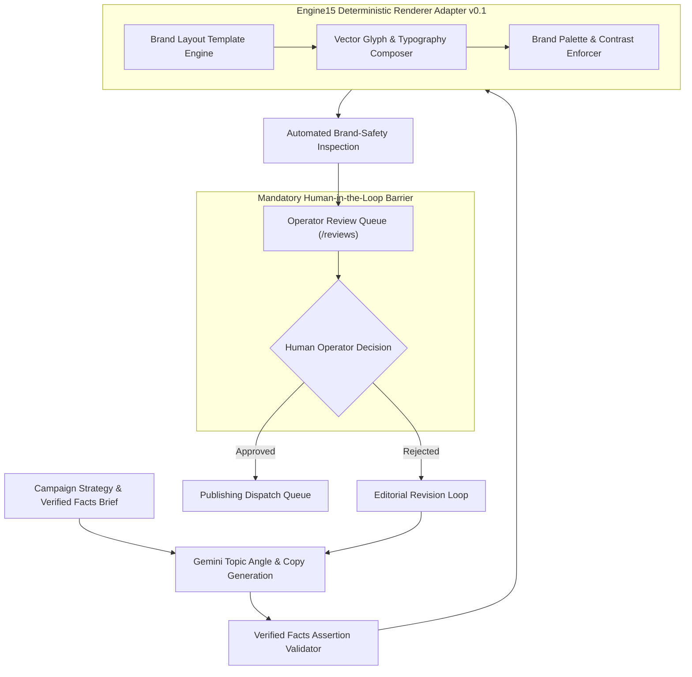

# YUJ Studio — AI Pipeline & Engine15 Architecture

## 1. AI & Deterministic Generation Philosophy

YUJ Studio rejects ungrounded, hallucinatory generative AI in marketing automation. Brand identities cannot tolerate unpredictable layout deviations, incorrect logos, or fabricated factual claims.

The creative generation pipeline couples **Large Language Model assistance (Gemini API)** for semantic angle ideation with **Engine15 Renderer Adapter v0.1** for pixel-deterministic, brand-safe visual synthesis.

---

## 2. Pipeline Stages

### Stage 1: Verified Facts Ingestion
- Every campaign brief ingest facts from verified company documentation (e.g., educational curriculum guidelines, eco-building certifications, verified customer testimonials).
- Hallucinated statistics or phantom claims are rejected at ingestion time.

### Stage 2: Engine15 Creative Synthesis
- **Deterministic Composition**: Rather than treating imagery as uncontrolled diffusion pixels, Engine15 renders layered vector graphics, brand typographic scales, and exact hex tokens (`#0B0E13`, `#FF873E`, `#27C7C1`, etc.).
- **Logo Safety Margin**: Guarantees padding zones around brand glyphs.
- **WCAG AA Contrast Guarantee**: Background and foreground contrast ratios are measured mathematically before the graphic is rendered.

### Stage 3: Automated Quality Inspection
- Validates that resolution adheres to target platform specifications:
  - Instagram Post: 1080x1080 (1:1) or 1080x1350 (4:5).
  - Instagram Story / Reel: 1080x1920 (9:16).
  - LinkedIn Feed: 1200x627 or 1080x1080.

### Stage 4: Mandatory Human Review Gate
- No creative can be published automatically.
- The human operator reviews both copy and image visual in the Review Queue.
- Rejection captures structured feedback to guide the next iteration.

### Stage 5: Audience Sentiment Telemetry (Gemini NLP)
- Analyzes incoming comments and mentions across connected Meta and LinkedIn accounts.
- Categorizes sentiment into Positive, Neutral, or Negative without storing private user identifiers.
