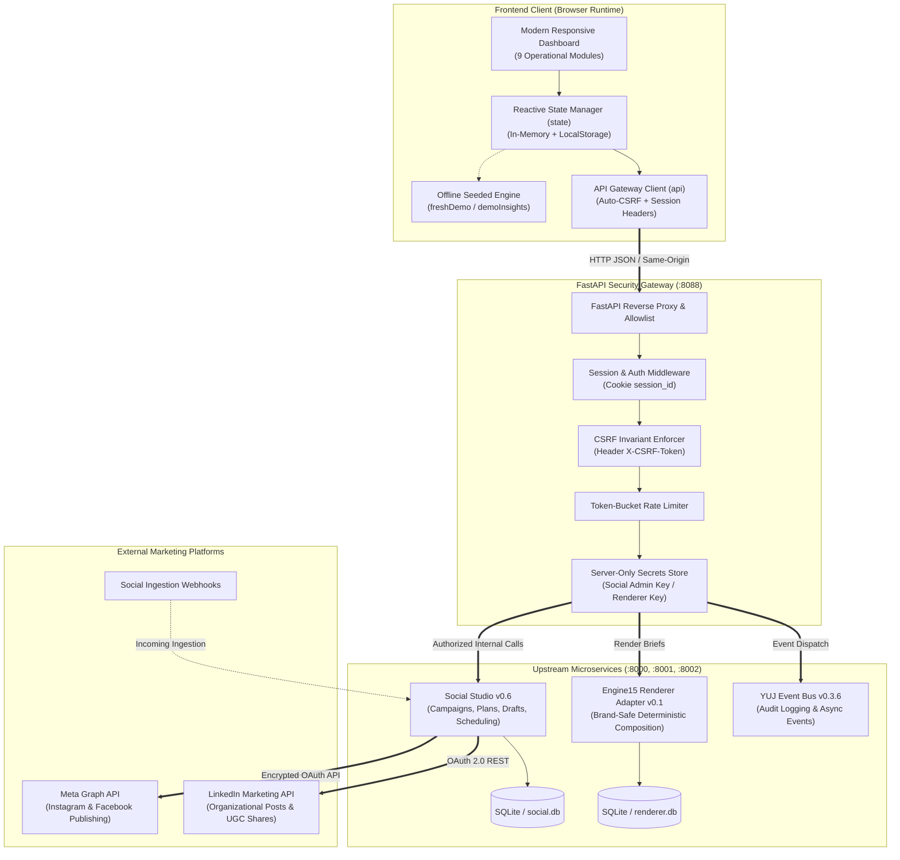

# YUJ Studio — System Architecture Specification

## 1. Executive Architecture Overview

**YUJ Studio (Marketing Intelligence OS / 01)** is a unified marketing automation and analytics platform connecting strategic intent, creative generation, human verification, scheduled multi-platform publishing, and performance measurement.

The architecture strictly enforces **zero-phantom metrics**, **deterministic brand safety**, **credential isolation**, and **mandatory human-in-the-loop approvals**.

---

## 2. Component Boundaries & Core Invariants

### A. Frontend Boundary
- **Zero-Build Vanilla Architecture**: Pure ES2022 JavaScript, CSS3, and semantic HTML5. No bloated bundlers, Webpack, or Babel. Instant load times and complete transparency.
- **Offline / Online Dual Execution**:
  - `Demo Mode`: Operates 100% offline with zero external network calls. Pre-seeded campaign portfolios, simulated approval transitions, and audited demo metrics.
  - `Live Mode`: Operates strictly against the FastAPI Security Gateway using credentials held on the server.
- **Zero-Phantom Data Principle**: Never synthesize fake reach, conversions, impressions, or ROI. Missing or unobserved metrics render strictly as em dashes (`—`).

### B. Security Gateway Boundary
- **Credential Isolation**: Client applications never receive Meta access tokens, LinkedIn secrets, or database master keys. All external platform communication originates server-side.
- **CSRF Protection**: All state-mutating requests (`POST`, `PUT`, `DELETE`) require an active session and a valid `X-CSRF-Token` header.
- **Route Allowlisting**: Only explicitly enumerated API routes are proxied to upstream services. Unrecognized routes trigger `404 Not Found` or `403 Forbidden`.
- **Timing-Safe Cryptography**: Authentication tokens and password hashes are verified using constant-time comparisons (`hmac.compare_digest`) to prevent timing attack vulnerabilities.

### C. Upstream Microservices Layer
- **Social Studio v0.6**: Manages campaign lifecycles, editorial weekly planners, slot allocations, draft reviews, and scheduling queues.
- **Engine15 Renderer Adapter v0.1**: Translates campaign briefs into pixel-perfect brand visuals grounded in verified facts. No unverified or hallucinatory images are ever composed.
- **YUJ Event Bus v0.3.6**: Centralized telemetry bus capturing immutable audit records for campaign creation, draft sign-offs, and publishing dispatches.

---

## 3. Communication Protocols

| Leg | Protocol | Transport | Auth Mechanism | Payload Format |
|---|---|---|---|---|
| Browser → Gateway | HTTPS / HTTP (Dev) | TCP | Cookie (`session_id`) + Header (`X-CSRF-Token`) | JSON |
| Gateway → Social Studio | HTTP (Internal) | Private Network / localhost | Bearer Admin Key (`SOCIAL_ADMIN_KEY`) | JSON |
| Gateway → Engine15 | HTTP (Internal) | Private Network / localhost | Header Key (`RENDERER_API_KEY`) | JSON / Multipart |
| Social Studio → Meta Graph | HTTPS | Public Internet | Long-Lived System User Access Token | JSON REST |
| Social Studio → LinkedIn | HTTPS | Public Internet | OAuth 2.0 Bearer Token | JSON REST |
