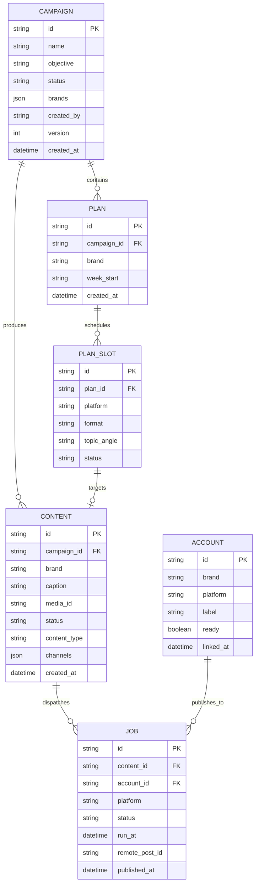

# YUJ Studio — Database Schema Specification

## 1. Relational Entity Overview

YUJ Studio stores operational state in SQLite datastores configured with Write-Ahead Logging (`WAL`) for high-concurrency read operations. The primary database is divided into **Social Studio Storage (`social.db`)** and **Renderer Cache (`renderer.db`)**.

---

## 2. Table Definitions & Fields

### `campaigns`
Stores strategic marketing initiatives.
- `id` (VARCHAR PK): Unique identifier (e.g. `life-education-oct`).
- `name` (VARCHAR): Campaign title.
- `objective` (VARCHAR): Strategic target (`awareness`, `sales`, `trust`, `leads`).
- `status` (VARCHAR): State machine (`draft`, `active`, `paused`, `archived`).
- `brands` (JSON TEXT): Array of associated brand keys.
- `created_at` (DATETIME): Inception timestamp.

### `plans` & `plan_slots`
Organizes editorial weekly schedules.
- `id` (VARCHAR PK): Weekly plan ID.
- `campaign_id` (VARCHAR FK): Associated campaign.
- `week_start` (DATE): Monday start date of editorial cycle.
- `topic_angle` (TEXT): High-level thematic brief for the slot.
- `platform` (VARCHAR): Channel target (`instagram`, `facebook`, `linkedin`).
- `format` (VARCHAR): Content type (`image`, `carousel`, `reel`, `story`).

### `content` (Drafts & Creatives)
Core entity subject to the mandatory human approval gate.
- `id` (VARCHAR PK): Content ID.
- `caption` (TEXT): Social post body text and copy.
- `media_id` (VARCHAR): Key referencing rendered visual composition.
- `status` (VARCHAR): Content lifecycle (`draft`, `review_ready`, `approved`, `rejected`, `published`).
- `brand` (VARCHAR): Brand identity key.
- `language` (VARCHAR): Copy language code (e.g. `en`, `hi`).

### `jobs` (Publishing Dispatches)
Represents queued and completed social dispatches.
- `id` (VARCHAR PK): Job identifier.
- `content_id` (VARCHAR FK): Link to approved content.
- `account_id` (VARCHAR FK): Social account target.
- `status` (VARCHAR): Queue status (`scheduled`, `held`, `published`, `failed`).
- `run_at` (DATETIME): Scheduled execution timestamp in ISO-8601 UTC.
- `remote_post_id` (VARCHAR): Platform receipt returned by Meta Graph or LinkedIn API.
- `published_at` (DATETIME): Verified timestamp of successful publication.

---

## 3. Data Integrity & Invariants

1. **Foreign Key Constraints**: All jobs must link to approved content records.
2. **Approval Verification**: A job cannot transition to `scheduled` unless `content.status == 'approved'`.
3. **Receipt Immutability**: Once `remote_post_id` is populated, the job record is finalized and cannot be overwritten.
