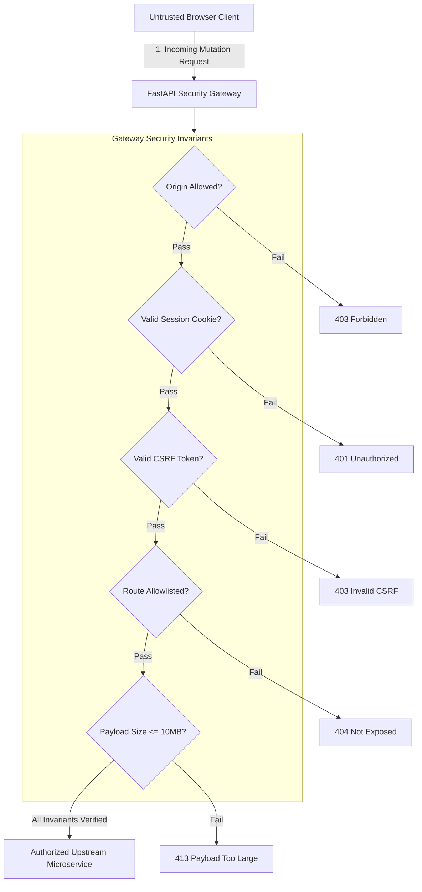

# YUJ Studio — Security Specification

## 1. Security Philosophy & Threat Model

YUJ Studio is designed for enterprise marketing operations where unauthorized social media dispatches can cause severe brand damage, legal exposure, or regulatory sanctions.

The platform enforces a **Zero-Trust Client** security model:
1. The browser runtime is considered untrusted.
2. No external platform API tokens (Meta App Tokens, Page Tokens, LinkedIn OAuth Keys) ever leave the backend gateway.
3. Every mutating action requires verified authentication, origin validation, and CSRF token proof.



---

## 2. Authentication & Session Management

- **Signed Session Cookies**: Operator sessions are issued as cryptographic HMAC-SHA256 signed tokens (`SESSION_COOKIE`), stored with `HttpOnly`, `SameSite=Strict`, and `Secure` attributes.
- **Timing-Safe Evaluation**: Password hashes and HMAC signatures are validated using `hmac.compare_digest` to eliminate timing side-channel attacks.
- **Session Expiration**: Sessions automatically invalidate after 12 hours (`43,200 seconds`).

---

## 3. Cross-Site Request Forgery (CSRF) Invariant

- Every operator session generates an associated CSRF token derived cryptographically from the session secret (`digest("csrf:" + token)`).
- For all state-mutating HTTP methods (`POST`, `PATCH`, `DELETE`), the gateway demands an identical `X-CSRF-Token` header.
- Cross-origin requests from foreign domains are blocked via strict `Origin` header validation against `YUJ_CONSOLE_ORIGIN`.

---

## 4. HTTP Security Headers

Every response emitted by the gateway includes hardened HTTP security headers:
```http
X-Content-Type-Options: nosniff
X-Frame-Options: DENY
Referrer-Policy: no-referrer
Permissions-Policy: camera=(), microphone=(), geolocation=()
Content-Security-Policy: default-src 'self'; script-src 'self'; style-src 'self' 'unsafe-inline'; img-src 'self' data: https: http:; connect-src 'self'; font-src 'self'; object-src 'none'; base-uri 'self'; frame-ancestors 'none'; form-action 'self'
Cache-Control: no-store (for all /api/* routes)
```

---

## 5. Rate Limiting & Denial-of-Service Defenses

- **Brute-Force Login Throttling**: The `/api/login` endpoint maintains sliding-window IP rate limiting (maximum 10 attempts per 5 minutes per client IP).
- **Payload Size Caps**: Requests exceeding 10MB are rejected immediately before body buffer allocation (`413 Payload Too Large`).
- **Response Size Caps**: Upstream microservice responses exceeding 4MB are dropped to prevent memory exhaustion attacks.
