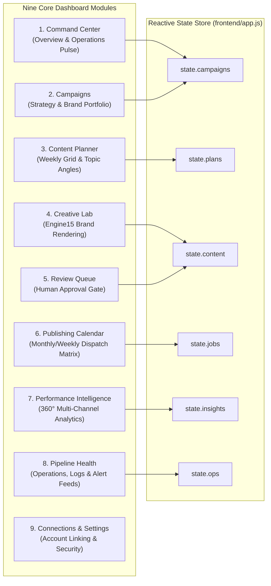
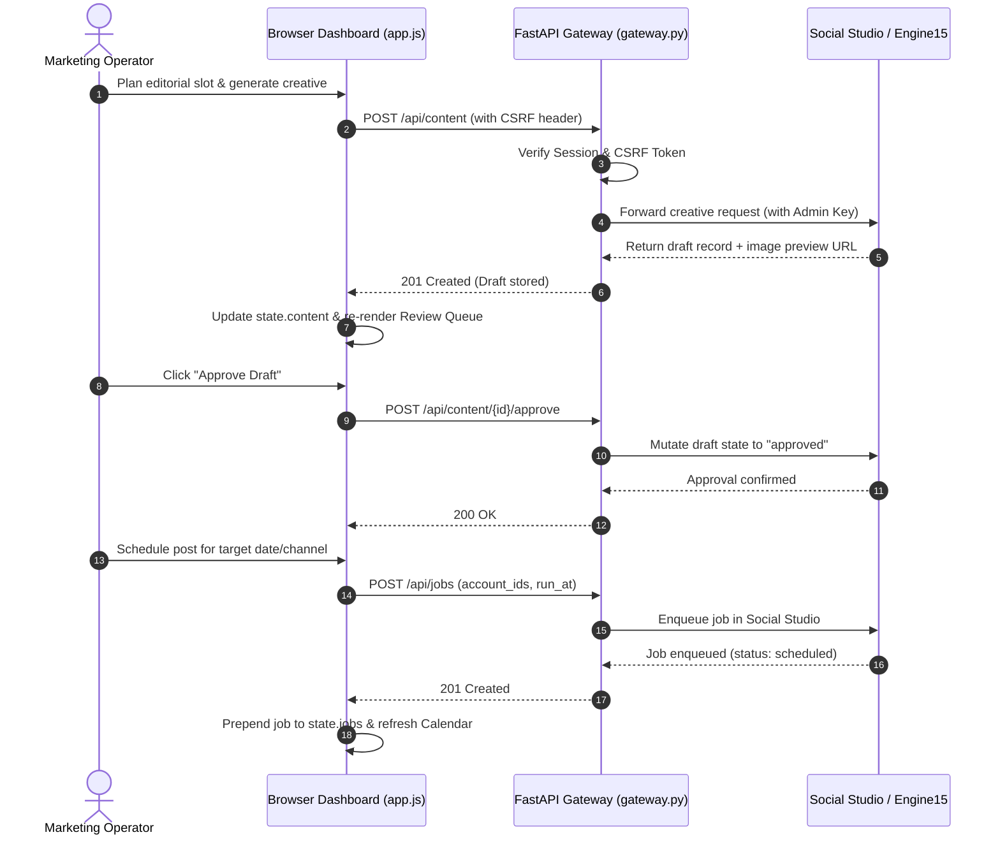

# YUJ Studio — System Design Specification

## 1. Modular System Decomposition

YUJ Studio is decomposed into nine operational frontend modules supported by a hardened security gateway and three upstream microservices.

---

## 2. Module Responsibilities & Features

### 1. Command Center (`/overview`)
- **Executive Pulse**: High-level visual dashboard summarizing active campaigns, pending approval count, in-flight creative jobs, and scheduled post counts.
- **Atmospheric Celestial Viewport**: Visual design inspired by next-gen marketing command centers with planet horizon curvature and atmospheric rim illumination.
- **Marketing Operations Pulse**: Real-time dual-series SVG line chart visualizing Reach and Views with interactive hover data tooltips.
- **End-to-End Pipeline Rail**: 5-stage interactive workflow showing live counts per stage with direct navigation.
- **Production Workbench & Decisions**: Quick-action preview of in-progress creative assets and pending review drafts.

### 2. Campaigns Module (`/campaigns`)
- **Lifecycle Management**: Create, view, filter, and archive marketing initiatives.
- **Brand Alignment**: Categorize campaigns across brand portfolios (`YUJ Foundation`, `YUJ World`, `YUJ GreenBuild`, `YUJ Ahaar`).
- **Strategic Objectives**: Support for Awareness, Trust, Lead Gen, and Commerce targets.

### 3. Content Planner (`/planner`)
- **Editorial Matrix**: Plan topic angles across weekly calendar slots.
- **Platform Targeting**: Map individual slots to target channels (Instagram, Facebook, LinkedIn).
- **Format Selection**: Distinguish between Carousel, Reel/Short, Static Single Image, and Story formats.

### 4. Creative Lab (`/creative`)
- **Engine15 Integration**: Parameterized creative generation interface allowing brand identity injection, verified fact inputs, and typographic style templates.
- **Brand-Safe Layouts**: Pre-validated compositional layouts guaranteeing logo protection zones and color contrast compliance.

### 5. Review Queue (`/reviews`)
- **Mandatory Human-in-the-Loop Checkpoint**: Strict approval barrier preventing unapproved content from reaching scheduling queues.
- **Inspection Drawer**: Full-screen modal to examine creative preview, copy text, hashtags, target platforms, and brand guidelines compliance.
- **Actions**: One-click *Approve* (moves to scheduled queue) or *Reject with Reason* (returns to draft revisions).

### 6. Publishing Calendar (`/calendar`)
- **3-Part Interactive Workspace**:
  - Left navigation & platform/status filter toolbar.
  - Center 7-column monthly grid with day cells, status-colored job chips, and overflow triggers.
  - Right contextual daily schedule inspector grouping scheduled posts by chronological time slots.
- **Job Rescheduling**: Supports inline time updates via `POST /v1/jobs/{id}/reschedule`.

### 7. Performance Intelligence (`/analytics`)
- **Executive 7-Card KPI Strip**: Total Impressions, Unique Reach, Engagement Rate, Positive Sentiment, Total Conversions, Earned Media Value (EMV), and Blended ROAS.
- **Daily Engagement Trend**: Multi-series line chart with dual curves (Engagements & Views) and milestone annotations.
- **Platform Reach vs Target (%)**: Comparison bar chart against a 75% target threshold.
- **Share of Voice (SOV) & Sentiment**: Segmented category mentions and natural language sentiment distribution.
- **Top Posts Data Table**: Searchable and sortable performance records.

### 8. Pipeline Health (`/operations`)
- **Infrastructure Status**: Telemetry health for SQLite, Event Bus, Engine15 Renderer, and Meta Publisher.
- **Real-Time Alert Feed**: Categorized incident alerts (Critical, Warning, Informational) with direct resolution guidance.

### 9. Connections & Settings (`/settings`)
- **Platform Linking**: Manage Meta Graph API accounts and LinkedIn OAuth connections.
- **Security Audit Logs**: View operator session records, CSRF token status, and gateway configuration.

---

## 3. Data Flow and State Synchronization

