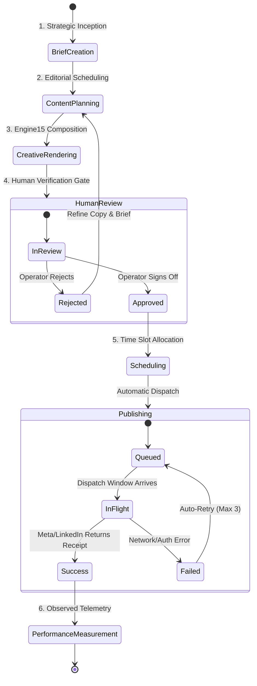

# YUJ Studio — End-to-End Marketing Workflow

## 1. Unified Content Journey

The YUJ Studio marketing journey is structured into five distinct phases, moving from strategic brief to verified real-world audience impact.

---

## 2. Detailed Lifecycle Stages

### Phase 1: Strategic Brief (`/campaigns`)
- Define campaign intent (Awareness, Trust, Sales, Community).
- Select target brand portfolios.
- Set target KPIs (Reach targets, impression benchmarks, ROAS goals).

### Phase 2: Editorial Planning (`/planner`)
- Plan topic angles across weekly calendar slots.
- Assign target distribution channels (Instagram, Facebook, LinkedIn).
- Select content formats (Single image, multi-slide carousel, short-form video).

### Phase 3: Creative Production (`/creative`)
- Inject verified facts into Engine15 Renderer Adapter.
- Render deterministic brand compositions.
- Generate synchronized caption suggestions and hashtags.

### Phase 4: Human Review Gate (`/reviews`)
- Operator inspects high-resolution visual previews, copy, and platform targets.
- **Approval Path**: Approving immediately unlocks the scheduling modal.
- **Rejection Path**: Rejection flags the draft with comments and returns it to the planning queue for revision.

### Phase 5: Scheduling & Publishing (`/calendar`)
- Select target calendar date and time (timezone: `Asia/Kolkata`).
- Dispatcher executes scheduled HTTP call to Meta Graph API or LinkedIn Marketing API.
- Upon successful publication, captures the remote post receipt (`remote_post_id`) for immutable provenance.

### Phase 6: Performance Intelligence (`/analytics`)
- Aggregates verified audience engagement (Impressions, Reach, Likes, Comments, Saves, Shares).
- Compares channel performance against benchmarks.
- Feeds observed insights back into Phase 1 to guide future campaign briefs.
